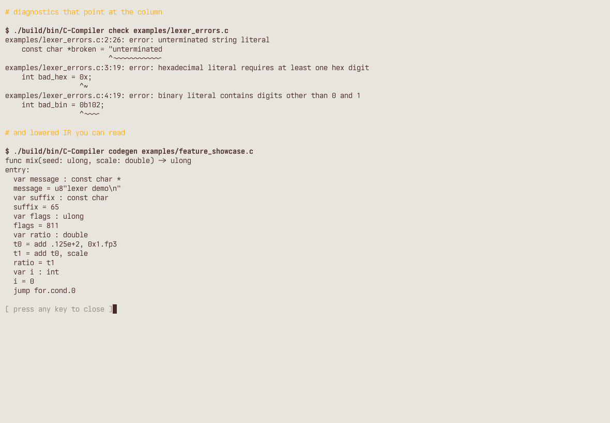

# Lumi-Compiler

[](https://github.com/IzonIcy/LumiComp/actions/workflows/ci.yml)

Lumi-Compiler is a C compiler written in C that carries a subset of the language from source to either readable textual IR or x86-64 assembly, built for people who want to read a complete compiler and watch each stage run on a file they can edit.

Build it and push one file through the pipeline:

```sh
make && ./build/bin/C-Compiler check examples/feature_showcase.c
```



A 37 second recording of that pipeline running end to end is in [docs/images/demo.mp4](docs/images/demo.mp4). `docs/demo.md` has the script it runs and how to shoot it again.

Or go all the way to a binary:

```sh
./build/bin/C-Compiler build examples/asm_hello.c hello && ./hello
```

## How it compares

chibicc is the other small C compiler people read to learn how one works, and it still goes further: more of the language, self-hosting, and a longer track record. LumiComp covers a narrower subset and writes x86-64 assembly with no register allocation at all, every value in a stack slot, which makes the output correct before it is fast. That trade is deliberate: the backend is about 3,400 lines you can read in an afternoon. clang is the compiler to reach for when you want to build and run real C. Nothing here replaces it.

## The pipeline

Roughly 14,000 lines across `src/` and `include/`, one concern per file. The front end is about 10,600 of them; the x86-64 backend is the rest. Each stage has its own subcommand, so you can stop and read the output anywhere.

### Lexer

- identifiers and C keywords
- integer literals in decimal, octal, and hexadecimal, plus a 0b-style binary extension
- floating literals, including hexadecimal floats such as `0x1.fp3`
- string and character literals with `u8`, `u`, `U`, and `L` prefixes
- comments, digraphs, and multi-character punctuators

### Preprocessor

- quoted includes, `#include "file.h"`
- local angle-bracket includes, `#include <file.h>`
- object-like and function-like `#define`, plus `#undef`
- `#if`, `#ifdef`, `#ifndef`, `#elif`, `#else`, and `#endif`
- `defined(NAME)` and `defined NAME` expressions in `#if` and `#elif`
- macro expansion and token pasting with `##`

### Parser

A recursive-descent parser over a working C subset:

- typedefs, declarations, and function definitions
- pointer and array declarators, and parameter lists
- compound statements, labels, and goto
- if, for, while, do ... while, and switch
- case, default, return, break, and continue
- unary, binary, conditional, cast, call, member, and subscript expressions
- struct and union definitions with field declarations

### Semantic analysis

- scope and symbol-table tracking
- typedef resolution
- duplicate declaration checks and undeclared identifier checks
- function-call arity checks
- assignment and return-type validation
- struct and union tag resolution, field layout and alignment, and member access validation for `.` and `->`
- break, continue, case, and default validation
- label resolution for goto, with duplicate label, case, and default detection
- simple non-void return-path checks

### Code generation

The backend lowers the checked program to readable textual IR, covering loops, conditionals, switch statements, labels and goto, and folding constant integer expressions during lowering.

`src/ccompiler/x86.c` then walks that IR and writes x86-64 assembly, one value per stack slot, no register allocation. `C-Compiler build` assembles and links the result with the system `cc`. Assembly syntax follows the host object format, Mach-O on Darwin and ELF elsewhere.

## Build and run

Requirements: a C11 compiler such as clang or gcc, make, and clang if you want `make analyze`.

```sh
git clone https://github.com/IzonIcy/LumiComp.git
cd LumiComp
make
```

The binary lands at `build/bin/C-Compiler`. To put it on your PATH:

```sh
install -m 755 build/bin/C-Compiler /usr/local/bin/C-Compiler
```

That directory may need sudo.

Each stage is a subcommand:

```sh
./build/bin/C-Compiler lex examples/feature_showcase.c
./build/bin/C-Compiler preprocess examples/feature_showcase.c
./build/bin/C-Compiler parse examples/feature_showcase.c
./build/bin/C-Compiler check examples/feature_showcase.c
./build/bin/C-Compiler codegen examples/feature_showcase.c
```

A bare path with no subcommand runs the lexer:

```sh
./build/bin/C-Compiler examples/feature_showcase.c
```

Add `--dump-tokens` for the token stream and `--dump-ast-json` for the AST as JSON.

## Example output

`check` on `examples/feature_showcase.c`:

```text
semantic analysis succeeded
functions: 2
globals: 0
typedefs: 1
```

`codegen` on the same file ends with:

```text
func main(void) -> int
entry:
  t15 = call mix(7, 0.25)
  t16 = cast int, t15
  ret t16
endfunc
```

## Verification

```sh
make test       # smoke suites plus golden IR regression
make analyze    # clang static analyzer
make verify     # both
```

The golden suite diffs the IR emitted for each case against the committed files in `tests/golden/`. A differential check also confirms that LumiComp and `clang -fsyntax-only` accept and reject the same test programs. Regenerate the goldens only after an intentional codegen change:

```sh
UPDATE_GOLDEN=1 sh tests/golden_smoke.sh
```

Run the suites under ASan and UBSan with `make sanitizers`.

Fuzz with the portable harness:

```sh
make fuzz
./build/bin/fuzz-standalone examples/*.c
```

On systems with the libFuzzer runtime, such as Linux with clang, build the coverage-guided harness instead:

```sh
make fuzz-libfuzzer
mkdir -p build/fuzz-corpus
cp examples/*.c tests/*.c build/fuzz-corpus/
./build/bin/fuzz-pipeline -max_total_time=60 build/fuzz-corpus
```

`.github/workflows/ci.yml` runs a clang and gcc matrix, static analysis, sanitizer-backed tests, a warnings-as-errors build, and a short fuzzing smoke run on pushes and pull requests.

## What it does not do yet

- The assembly target covers integers, doubles, pointers, control flow and calls, not the whole language. Structs, local arrays, single-precision floats, `sizeof`, and more than six integer call arguments are rejected with a located diagnostic.
- No include search path. `#include` resolves next to the including file or from an absolute path, so `#include <stdio.h>` fails to open.
- Preprocessor coverage stays on local includes and common macro flows.
- Bit-fields, flexible array members, and full function-pointer coverage are incomplete.
- No optimization passes. Folding constant integer expressions during lowering is all the backend does.
